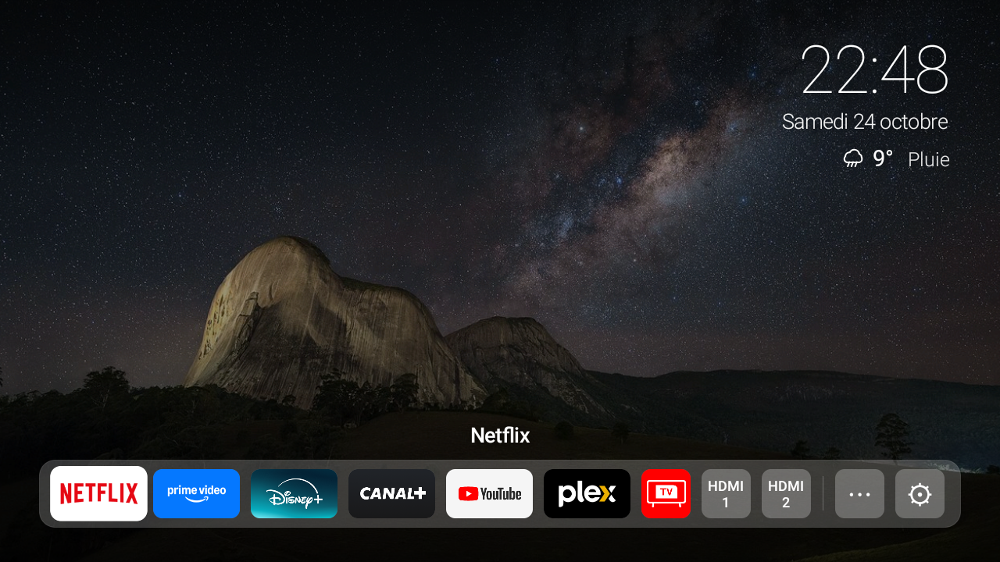
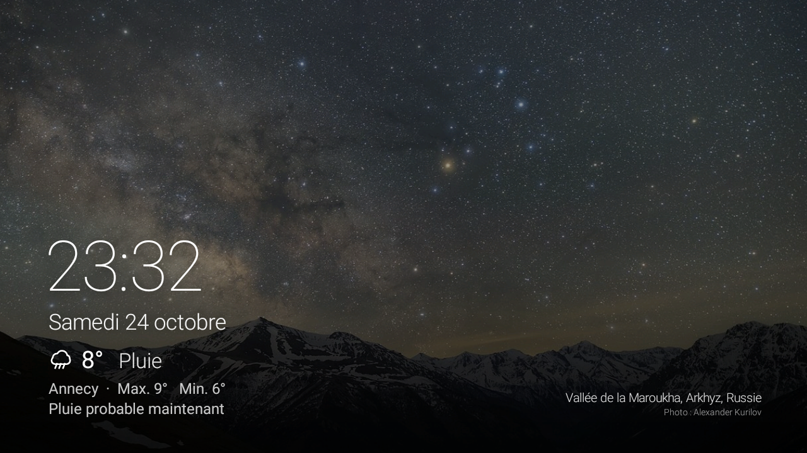

# PuriTV

**Purifie ton Android TV** : sans pubs ni télémétrie, plus rapide, avec un écran d'accueil minimaliste façon Apple TV. Tout est réversible en un double-clic.





## Ce que fait PuriTV

**Allègement guidé (depuis ton PC Windows)**
- Désactive les pubs du fabricant, la télémétrie et les applis inutiles, **en te demandant avant chaque catégorie**.
- Ne désinstalle jamais rien : les applis sont seulement désactivées pour ton profil.
- Fait une **sauvegarde complète** de la télé avant le moindre changement, et note chaque modification.
- Ne touche jamais à ce qui fait marcher la télé : image, son, chaînes, entrées HDMI, télécommande, Chromecast, Play Store.

**Écran d'accueil PuriTV (sur la télé)**
- Photos de paysages en plein écran qui défilent en fondu, et version nuit de 21 h à 7 h.
- Heure, date et météo de ta ville (Open-Meteo, sans compte).
- Dock de tes applis préférées : appui long sur OK pour ajouter, déplacer ou retirer une appli.
- Accès direct aux entrées HDMI et grille « Toutes les applis ».
- Économiseur d'écran assorti : heure, prévisions, lieu de la photo et vigilances Météo-France (en France).
- Libère la mémoire des applis restées ouvertes quand la télé est inactive.
- Tout se règle à la télécommande dans **⚙ › Réglages PuriTV** : ville, délai de l'économiseur d'écran, mise en veille, mémoire, alertes, bloqueur de pubs.

**Options**
- Animations 2 fois plus rapides.
- Bloqueur de pubs par DNS (AdGuard), qui se coupe tout seul si un réseau ne le permet pas.
- HDMI-CEC, pour piloter une console ou une box avec la télécommande de la télé.

## Télés testées

| Télé | Android | Profil |
|---|---|---|
| TCL (UnionTV) | 9 | [`profils/tcl-android9.json`](profils/tcl-android9.json) |

Sur une autre télé, PuriTV utilise un profil prudent qui ne propose que des éléments Google courants ([`profils/android-tv-generique.json`](profils/android-tv-generique.json)). **Les profils pour d'autres télés sont les bienvenus**, voir [Contribuer](#contribuer).

## Installation

**Il te faut** un PC Windows 10 ou 11, sur le même réseau que la télé.

1. **Sur la télé**, active le mode développeur :
   - **Paramètres › Système › À propos** : appuie 7 fois sur **Build**.
   - **Paramètres › Système › Options pour les développeurs** : active **Débogage USB**.
2. **Sur le PC**, télécharge le projet (bouton vert **Code › Download ZIP**) et décompresse-le.
3. Télécharge **`PuriTV.apk`** depuis la page [Releases](../../releases) et place-le à côté de `installer.bat`.
4. Double-clique sur **`installer.bat`** et laisse-toi guider. Les outils Android (adb) sont installés automatiquement si besoin.
5. À la première connexion, la télé affiche « Autoriser le débogage ? » : coche **Toujours autoriser** puis **OK**.

Pour voir ce que l'installateur ferait sans rien changer :

```bash
powershell -ExecutionPolicy Bypass -File installer.ps1 -Simulation
```

## Au quotidien

| Fichier | À quoi il sert |
|---|---|
| `installer.bat` | Installation guidée. On peut le relancer pour compléter. |
| `verifier-tv.bat` | Après une mise à jour de la télé : remet ce qu'elle aurait annulé (applis réactivées, réglages). |
| `activer-verification-auto.bat` | Vérification automatique chaque semaine. À lancer avec clic droit › Exécuter en tant qu'administrateur. |
| `restaurer-tv.bat` | **Remet la télé exactement comme avant** et désinstalle PuriTV. |

La télé est retrouvée toute seule sur le réseau, même si son adresse change, par exemple après un déménagement. Tout ce qui concerne **ta** télé reste sur ton PC dans `sauvegarde-tv\` et `config-tv.json`, et n'est jamais publié.

## Bon à savoir

- **Bloqueur de pubs DNS :** il ne bloque pas les pubs de YouTube ni de Netflix, qui viennent de leurs propres serveurs. Si une appli ne charge plus, coupe-le dans ⚙ › Réglages PuriTV.
- **Le mode développeur** reste actif pour que les scripts puissent agir. Tu peux couper le débogage USB quand tu n'en as pas besoin, et le rallumer avant de lancer un script.
- **Horloge de certaines TCL :** quand la télé recale son heure sur le signal TV, Android cesse parfois d'envoyer le signal système de chaque minute. PuriTV a sa propre horloge et n'est pas concerné, mais d'autres applis peuvent l'être jusqu'au redémarrage de la télé.

## Compiler PuriTV soi-même

Pas besoin d'Android Studio ni de Gradle. Il faut :
- Java 17 : `winget install Microsoft.OpenJDK.17`
- le SDK Android en ligne de commande, avec `platforms;android-28` et `build-tools;34.0.0`

```bash
powershell -ExecutionPolicy Bypass -File app\build.ps1
```

Le script crée `PuriTV.apk` à la racine du projet, signé avec une clé générée sur ton PC (`app\puritv.keystore`, à conserver pour les mises à jour).

## Structure du projet

```
PuriTV/
├── installer.bat                      Installation guidée
├── verifier-tv.bat                    Vérification après une mise à jour de la télé
├── restaurer-tv.bat                   Retour à l'état d'origine
├── activer-verification-auto.bat      Vérification automatique chaque semaine
├── desactiver-verification-auto.bat
├── scripts/                           Scripts PowerShell appelés par les .bat
│   ├── tv-commun.ps1                  Connexion à la télé, sauvegarde, réglages, profils
│   ├── installer.ps1
│   ├── verifier-tv.ps1
│   ├── restaurer-tv.ps1
│   ├── verifier-auto.ps1
│   └── activer-verification-auto.ps1
├── profils/                           Applis à proposer et à ne jamais toucher, par modèle de télé
├── app/                               Appli Android PuriTV
│   ├── build.ps1                      Compilation sans Android Studio ni Gradle
│   ├── AndroidManifest.xml
│   ├── src/app/puritv/                Code Java
│   ├── res/
│   └── assets/                        Photos et lieux
└── docs/                              Captures d'écran du README
```

Créés sur ton PC et jamais publiés : `sauvegarde-tv/` (état d'origine de la télé et tout ce que PuriTV a changé), `config-tv.json` (adresse et numéro de série de la télé), `PuriTV.apk` et la clé de signature.

## Contribuer

Le plus utile : **un profil pour ta télé**. Copie [`profils/tcl-android9.json`](profils/tcl-android9.json), adapte `correspond` (fabricant et version d'Android, voir `adb shell getprop ro.product.manufacturer`), et range les applis par catégories. Mets dans `jamais` tout ce qui fait marcher la télé. Teste avec `installer.ps1 -Simulation`, puis propose-le en pull request.

## Avertissement

PuriTV modifie des réglages de ta télé avec les outils officiels d'Android, de façon réversible. Il est fourni tel quel, sans garantie : vérifie ce que tu acceptes de désactiver. En cas de souci, `restaurer-tv.bat` remet tout comme avant.

## Licences

- Le code est sous [licence MIT](LICENSE).
- Les photos viennent de Wikimedia Commons, sous licences Creative Commons (CC BY / CC BY-SA) : auteurs, lieux et liens dans [`CREDITS.md`](CREDITS.md). Le photographe est aussi crédité à l'écran.
- La météo vient d'[Open-Meteo](https://open-meteo.com) et les vigilances de Météo-France, via [MeteoAlarm](https://meteoalarm.org).
- PuriTV n'est lié ni à Apple, ni à Google, ni à TCL.
